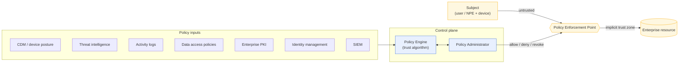

# Core Logical Components (after NIST SP 800-207 §3)

My own drawing of the abstract model: a subject on an untrusted path reaches an enterprise
resource only through a Policy Enforcement Point, which the Policy Decision Point controls.

**How to read it**

- **PE + PA = PDP.** The PE decides; the PA carries the decision out by configuring the PEP.
- The **implicit trust zone** behind the PEP should be as small as possible. Shrinking it is
  what micro-segmentation does.
- The policy inputs are the same sources listed in the 800-207 summary
  (`docs/nist_800-207_summary.md`).
