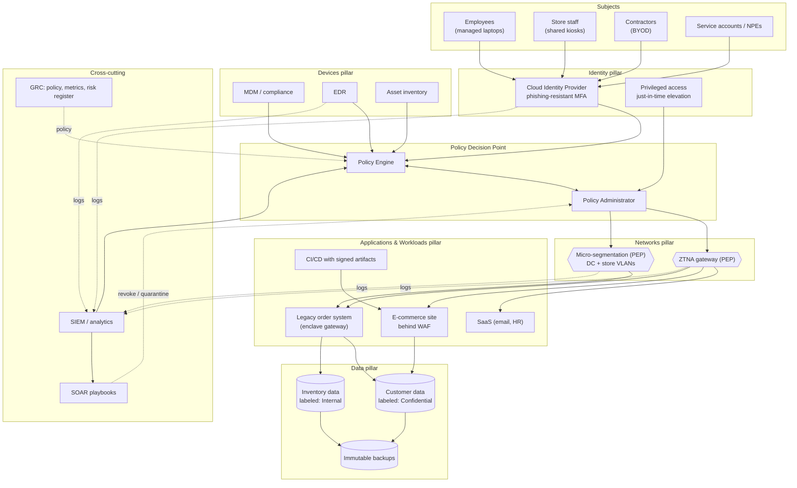

# Reference Architecture: Kestrel Ridge Outfitters (fictional)

**Scenario (fictional):** a mid-size outdoor-gear retailer with a headquarters, two
distribution centers, about 40 stores, an e-commerce site, and a mix of SaaS, cloud workloads
and one legacy on-prem order system. This is the target state the maturity worksheet
(`assessment/maturity_worksheet.csv`) is working toward.

**Design choices worth noting**

- **Store kiosks** are a known weak spot (shared devices). They get a tighter policy:
  inventory data only, no customer data, and sessions bound to kiosk device identity.
- The **legacy order system** can't take modern auth, so it sits behind an *enclave
  gateway* (800-207 §3.2.2) instead of being rewritten up front.
- **SOAR → PA** closes the loop: a detection can revoke a session without a human in the
  path. This is what moves Automation & Orchestration from Traditional toward Advanced.
