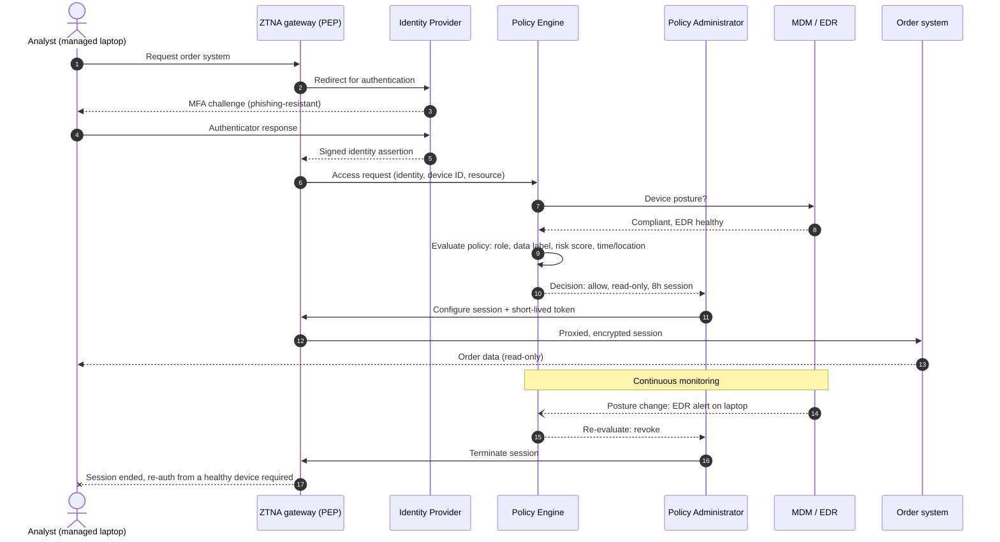

# Access Request Flow (fictional scenario)

An analyst at Kestrel Ridge Outfitters (fictional) opens the order system from a managed
laptop. The sequence shows per-session evaluation (tenet T3), dynamic policy (T4) and
continuous re-evaluation (T5/T6).

